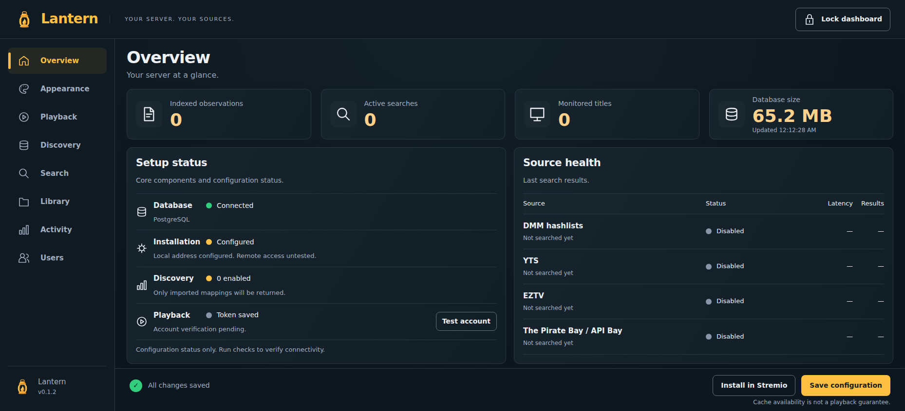

<p align="center"></p>

# Lantern

**Your server. Your sources.**

Lantern is a self-hosted Stremio addon for people who want to manage their own source discovery, matching preferences, and private installation. It finds movie and episode releases, keeps a local metadata index, and resolves selected streams through your Real-Debrid account.

The dashboard explains what was found, why results were excluded, and whether a source responded. Lantern stores metadata, not videos. It does not proxy or transcode playback.



*Actual application screenshot using isolated demonstration data. Statuses and counts are examples, not live provider measurements.*

## Features

- Discovery through YTS, EZTV, and API Bay, with optional bounded DMM hashlist imports.
- Movie and exact-episode matching, duplicate removal, and explainable filtering.
- Quality, size, seeder, language, result-limit, and stream-presentation preferences.
- Refresh of explicitly monitored titles and administrator-supplied mappings.
- Source health, import reports, filename cleanup previews, and activity history.
- Up to 50 invited profiles with separate Real-Debrid tokens and installation links.
- PostgreSQL persistence and encryption of saved settings and provider credentials.

## How it works

1. **Sources** supply release metadata. Cinemeta supplies movie/show names and years.
2. **The local index** remembers matching observations. Optional DMM staging supplies additional candidates. A fresh server starts without a populated catalog.
3. **Matching and filters** select relevant files and explain exclusions. Language and filename tags come from names, not video inspection.
4. **Real-Debrid** resolves the selected release at playback time. Stremio receives a provider URL rather than a video stream from Lantern.

Real-Debrid is the only implemented playback provider. Streaming requires your own usable account and API token; guests need their own tokens. Discovery can be evaluated without one. Direct P2P is disabled; a legacy saved P2P setting cannot produce streams. Torrentio, Jackett, Prowlarr, and Zilean are not runtime dependencies.

**Finding a result does not confirm that it is cached, accepted, or playable.** Uncached releases may require provider downloading. Account tests verify account access, not a particular stream. Services can block, throttle, change, or return no results.

Monitoring refreshes an exact movie or episode; searching alone does not enable it. There are no email/push notifications, whole-show subscriptions, or automatic playback failover. Coverage and conservative matching are incomplete. Use sources and media you are authorized to access.

## Quick start — Docker Hub

The project-maintained image is [`jctechmin/lantern`](https://hub.docker.com/r/jctechmin/lantern). The production Compose example pins `0.1.1`; see [image tags, publishing status, and deployment](docs/DOCKER.md). The original `compose.yaml` remains available for local source builds.

Requires Docker Engine with the Compose plugin, Git (or a source archive), and OpenSSL. For Ubuntu, follow [Docker's installation instructions](https://docs.docker.com/engine/install/ubuntu/). Node is included in the image.

```sh
git clone https://github.com/jtechbyte/lantern.git
cd lantern
sh scripts/setup.sh
# Edit .env for public HTTPS access; preserve generated secrets.
docker compose -f compose.image.yaml config --quiet
docker compose -f compose.image.yaml pull
docker compose -f compose.image.yaml up -d --wait --wait-timeout 120
curl -fsS http://127.0.0.1:7001/healthz
```

For local evaluation open **http://localhost:7001**. Unlock with `ADMIN_TOKEN` from your private `.env`. In **Playback**, enter your Real-Debrid token, **Save configuration**, then **Test account**. Choose discovery sources, save, and use **Install in Stremio**.

For a remote server, configure `PUBLIC_URL` and HTTPS using [Installation](docs/INSTALLATION.md). A Stremio device cannot reach your server through its own localhost. Existing SQLite installations require an explicit migration.

## Documentation

- [Docker Hub image, versions, and production deployment](docs/DOCKER.md)
- [Installation, environment, HTTPS, migration, and first use](docs/INSTALLATION.md)
- [User guide: every section and subtab](docs/USER_GUIDE.md)
- [Updates, backup, restore, and rollback](docs/OPERATIONS.md)
- [Troubleshooting](docs/TROUBLESHOOTING.md)
- [Contributing and development](CONTRIBUTING.md)
- [Security and private reports](SECURITY.md)
- [Changelog](CHANGELOG.md) · [Release notes and verification limits](docs/RELEASE_NOTES.md) · [Preparation checks](docs/RELEASE_PREPARATION.md)
- [Third-party notices](THIRD_PARTY_NOTICES.md)

## Release status

Version 0.1.1 adds production image packaging and native container checks. See [Docker deployment](docs/DOCKER.md) for actual publication and architecture verification status. Public TLS routing and authenticated Real-Debrid/Stremio playback remain separate acceptance checks; automated tests do not establish universal playback availability.

## License

[MIT](LICENSE), copyright 2026 jtechbyte. Dependencies retain their own licenses. Lantern is independent of Stremio, Real-Debrid, and the discovery services.
