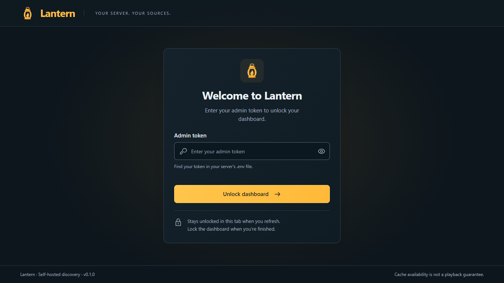

# Using Lantern

## Unlock, save, and lock

The owner unlocks with `ADMIN_TOKEN` from the server's `.env`. The input is masked by default; the eye button toggles visibility. Enter submits. The token is stored in this tab's session storage so refresh stays unlocked. **Lock dashboard** clears that tab's credential; it does not revoke other tabs, guest profiles, or Stremio installations.

Settings edits remain in the form while switching sections. **Save configuration** persists them; the bottom bar distinguishes unsaved, saving, saved, and failed states. Most settings need this action. Operational buttons such as monitoring, imports, token removal, cleanup, invitation creation, and revocation act immediately. **Restore recommended discovery settings** also writes immediately after confirmation and discards unsaved edits.

*Screenshots in this guide show the actual application with isolated demonstration data, not conceptual mockups or live provider results.*

## Overview

**Indexed observations** counts stored observations, not unique available movies. **Active searches** counts work in progress. **Monitored titles** counts explicitly watched movie/episode IDs. Setup rows distinguish database connectivity, installation address configuration, enabled discovery, and saved/tested playback credentials. **Test account** uses the saved owner token.

Source health shows the last response, latency, and result count. Responded can mean zero results; enabled is not connected. Untested and stale observations are not live health checks. Blocked/throttled states can include retry timing. The status is not a promise of playback.

## Appearance

**Branding:** display name (1–60 characters), description (up to 300), and optional HTTPS logo URL. Blank logo uses the bundled Lantern mark. The dashboard retains the product branding; the Stremio manifest uses your saved customization.

**Source appearance:** Clear, Compact, and Detailed layouts, icons, and reported seeders. **Preview layout** renders an example through the actual formatter without saving. Tags derive from release names, not inspection of video/audio. Save to apply changes to streams.

## Playback

**Account and delivery:** Real-Debrid is the working delivery mode. Legacy P2P settings are retained but disabled. Within each source/resolution, choose seeder or size ordering; higher resolutions and source balancing still apply. The legacy `quality` sort value retains the default seeder behavior.

Enter a replacement Real-Debrid API token and save before testing it. A blank replacement keeps the existing token. **Token saved** does not mean verified; **Test account** reports the saved account's response. **Remove token** immediately deletes it. A successful test does not establish that any specific release is playable.

Filename compatibility offers **Warn**, **Hide matches on known original names**, and **Off**. These empirical rules can reject valid releases and cannot guarantee provider acceptance. They do not rename files. Database filename blocking is a separate setting in Library.

**How playback works:** explains indexed releases, provider resolution, unknown cache availability, and possible provider downloading. Lantern redirects rather than relaying video. Provider failures may appear as generic errors in some clients.

## Discovery

**Result preferences:** maximum results (1–50), results per quality (1–20), maximum size (0–200 GiB; 0 unlimited), minimum reported P2P seeders (0–10,000), and preferred language. Language is a preference based on filename heuristics, not a verified audio language. Current preferences summarizes the current form, including unsaved edits.

**Quality and refresh:** exclude CAM/telesync, selected qualities, and choose refresh interval (15–1,440 minutes). This determines when cached searches become eligible again; it is not a notification interval. Default is 60 minutes.

**Discovery sources:** all four source controls stay visible together on desktop. Defaults enable YTS, EZTV, and API Bay; DMM is optional.

| Source | Behavior and limits |
| --- | --- |
| YTS | Movie metadata lookup by IMDb. |
| EZTV | Series lookup by IMDb; bounded to the first 200 results, so older episodes may be missed. |
| API Bay | Title searches with conservative matching; no authoritative file list. |
| DMM hashlists | Locally searched, imported public metadata; no reliable cache, seed-count, or authoritative IMDb guarantee. |

**Restore recommended discovery settings** resets discovery/filter/refresh settings and RD warning mode. It preserves branding, delivery, provider token, formatter preferences, installation identity, and imported mappings. Read the confirmation before applying.

## Search

**New search:** choose Movie with an IMDb ID such as `tt1254207`, or Series episode with `tt1234567:1:2`. Accepted IMDb IDs have 7–10 digits; episode IDs include numeric season and a positive episode. This is an ID search, not free-text title autocomplete.

**Search sources** inspects actual candidates; first searches can take up to 12 seconds. Source cooldowns still apply to forced searches. **Refresh status** refreshes operational information. Inputs/results remain while switching tabs.

**Monitor this title** adds this exact movie or episode, separately from searching. The minute worker revisits watched IDs when their refresh interval permits. Up to 50 can be monitored. There are no email, push, or in-app arrival notifications; inspect results and Activity or reopen the title in Stremio.

**Results:** selected releases and exclusion explanations cover indexed candidates. Quality, CAM, size, seeders, duplicates, per-quality caps, and total caps can exclude results. Upstream identity mismatches discarded before indexing do not appear here. Remove controls apply to explicit administrator mappings, not arbitrary source results.

## Library

### Filename policy

**Block filename-rule matches** checks release titles, torrent names, and selected filenames before saving. Strict filtering can exclude working releases. This is distinct from playback compatibility filtering. The rule-set identifier comes from the configured implementation.

**Preview database filename cleanup** reads a report and does not delete records. Review it under Reports before confirming **Remove matching records**. Removal changes stored data, including matching staged DMM candidates; back up first. Rules are empirical, and acceptance is never guaranteed.

### Monitored titles

Lists explicitly monitored movie/episode IDs. Remove an entry to stop future scheduled refresh for it. This does not erase already indexed results or cancel an external provider transfer.

### Installation

Copy the private manifest URL or install using the shared bottom action. **Revoke installation URL** rotates owner installation access after confirmation; reinstall in Stremio. It does not replace the admin token or guests' installations.

**Run automatic cleanup now** applies the normal retention policy immediately. Storage/cleanup details show actual recorded state. Automatic cleanup expires discovery/search records after seven days, targets 50,000 automatic releases and 10,000 search timestamps, and retains 200 events. Manual mappings, settings, tokens, and the watchlist are preserved by routine cleanup. Filename cleanup is a separate deliberate deletion operation.

### DMM imports

Enable DMM in Discovery and save. Automatic discovery (default on) scans the public catalog every six hours and imports up to two lists per background batch. It is metadata-only and makes no RD calls. Processing a large catalog can take days and does not create a complete mirror.

For manual mode, turn automatic discovery off and save up to five public DMM hashlist HTML URLs. These refresh hourly. **Run sync now** starts eligible work; **Check import status** reads actual status, not a fabricated completion count. These actions require DMM enabled and automatic discovery or saved URLs.

At most 10,000 staged candidates are retained for seven days. Automatic imports pause under storage pressure. List/catalog response size and decoding limits bound resource usage. Accepted records may update existing hashes rather than increase totals. Failures, invalid records, filename exclusions, queue counts, and partial/catalog errors refer to the actual batch/report.

### Manual imports

Import 1–100 JSON mappings you have identified yourself. Required fields are `type` (`movie`/`series`), `mediaId`, `title`, and a nonzero 40-hex-character `infoHash`. Optional fields: `torrentName`, zero-based `fileIdx`, `filePath`, byte `size`, and nonnegative `seeders`. Unknown fields are rejected. Use real identified data; the UI's JSON example is illustrative.

Episode file indexes refer to the original torrent order; provider selection still checks the exact episode. Filename policy applies during import. Manual mappings persist through routine cleanup and are private to owner streams, not guest streams.

### Reports

View DMM import status and filename cleanup reports after the corresponding operation. Reports use pages where needed; changing report pages does not run another import or cleanup. A preview is not a completed deletion.

## Activity

The main panel shows the newest entries that fit the viewport, with **Latest N of M entries**. **View full history** opens retained records in a scrolling history view. **View details** shows complete event information; new activity does not replace an open detail snapshot. Completed, failure counts, and partial success come from event data. History is bounded by the 200-event retention policy, not an indefinite audit archive.

## Users

Create a labeled, single-use invitation expiring after 48 hours. Copy and share it privately yourself; Lantern sends no email. The original invitation is shown at creation. Refresh retrieves real profiles and capacity (50 maximum, including expired/revoked entries until removed).

Recipients accept the invitation, save their private management link, enter their own Real-Debrid token, save/test it, and install their personal addon. Their management credential is stored in tab session storage; **Lock profile** clears it. Keep the management link for reopening. Guests can adjust personal filters/formatting, remove their token, or rotate their own installation URL.

Guests share the discovery index but cannot access owner controls, owner manual mappings, or another user's credentials. The operator holds the encryption key and must be trusted. Using the same provider token in multiple profiles still means the same provider account.

**Revoke** invalidates management/invitation/installation access and erases the stored provider token. Already-issued provider URLs or active transfers may work until the provider expires them. **Remove** deletes the profile and frees capacity. Lost management links are not recoverable through the dashboard; revoke/remove and invite again. Neither action deletes anything from the remote provider account.

### Overview database size

Database size measures the whole connected PostgreSQL database, including tables and indexes. It excludes cluster-wide WAL, backups, and other databases. Units are decimal (1 KB = 1,000 bytes); focus or hover over the value for exact bytes and the measurement time. Overview refreshes approximately every ten seconds while visible, with a shared five-second server cache. Failed measurements show Unavailable, or retain a clearly marked stale value and its original timestamp. Deleting rows does not necessarily reduce PostgreSQL allocation immediately.
